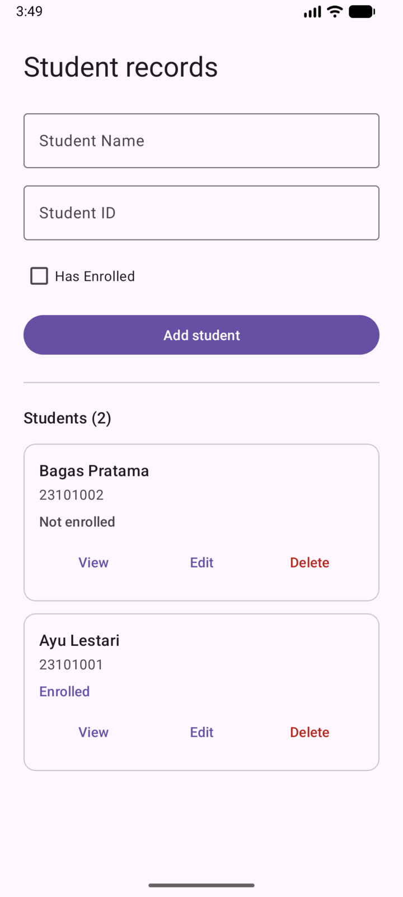
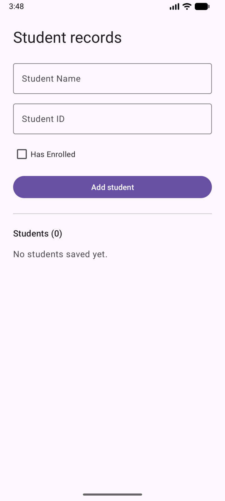
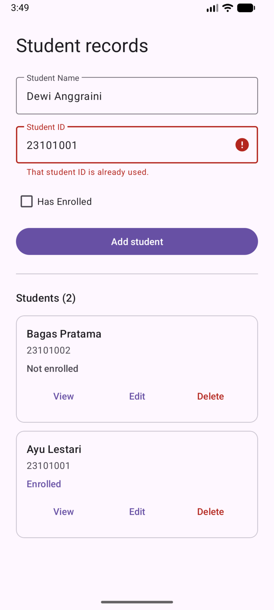
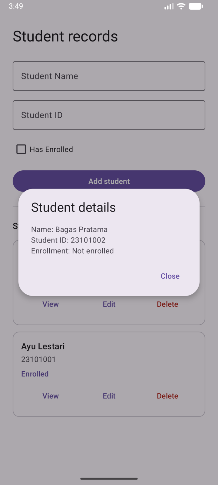
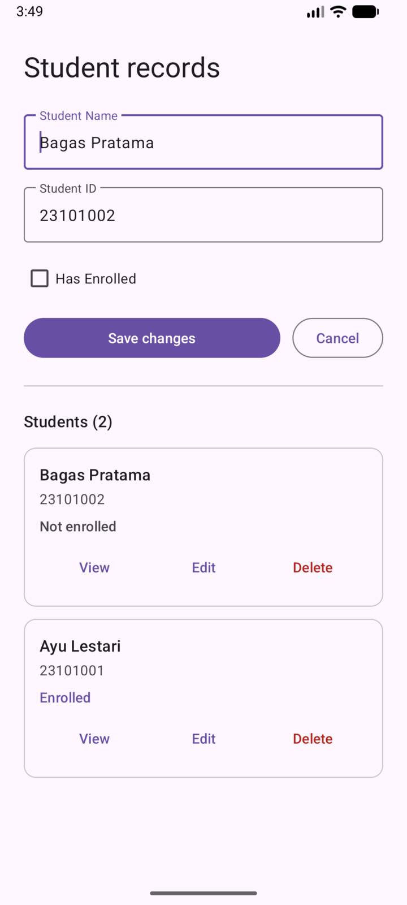
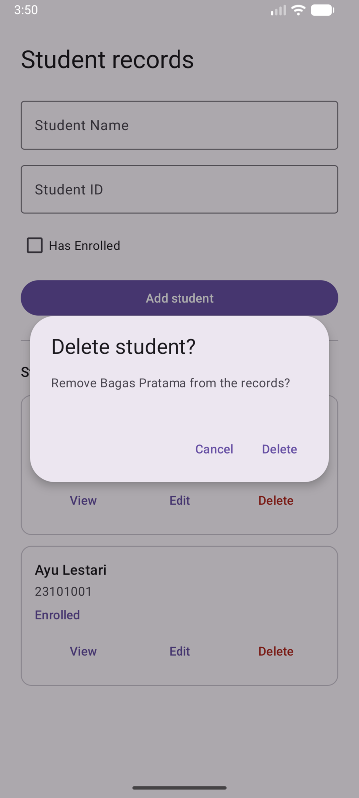
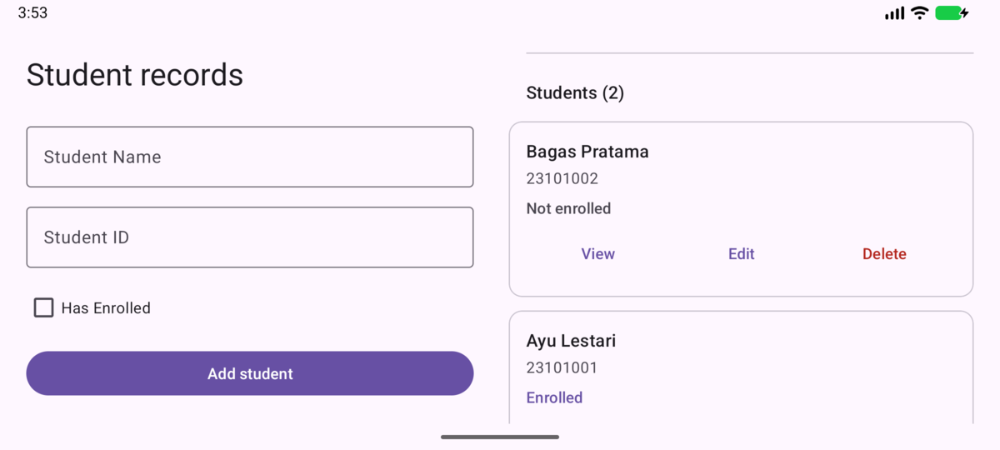

# Student Records

Mid Examination IT 2025, Class 2. Mobile Application Development.

Name: Dwiky Candra
Student ID: 001202500082
Class: M-IT Lect 2 Batch 2025
Case: 2 (even student ID)

This app stores student data in SQLite. Every record has a name, a student ID, and an enrollment status. Records can be added, viewed, edited, and deleted from the main screen.



## Screens

Empty list:



A student ID that is already used is rejected. The form keeps the typed values so nothing has to be entered again:



View shows the name, the student ID, and the enrollment status:



Edit fills the form with the selected record. The button changes to Save changes, and Cancel returns to the add form:



Delete asks for confirmation first:



In landscape the form and the list sit side by side:



Screenshots use sample data (Ayu Lestari, Bagas Pratama).

## Features

- Add a student with name, student ID, and enrollment status.
- View a record in a dialog with all three fields.
- Edit a record. The update goes to the same row.
- Delete a record after confirming.
- Student ID must be unique. Empty name or ID is rejected before saving.

## Database

File `students.db`, table `students`, schema version 1.

| Column | Type | Notes |
|---|---|---|
| `_id` | INTEGER | primary key, used by Edit and Delete |
| `name` | TEXT | not empty |
| `student_id` | TEXT | not empty, unique |
| `enrolled` | INTEGER | 0 or 1 |

Student ID is stored as text so an ID like `002` keeps its leading zeros. A unique index on the column prevents duplicate IDs, and the form reports the error under the Student ID field. Edit and Delete use the row `_id`, so correcting a student ID does not touch another row.

The database file is in the app's private storage, so it is removed when the app is uninstalled. A restart loads the same list, and a half filled form is never saved.

## Project files

| File | Contents |
|---|---|
| `Student.java` | One student record |
| `StudentDatabase.java` | Table creation and insert, select, update, delete |
| `MainActivity.java` | Form, validation, dialogs, list loading |
| `StudentAdapter.java` | One card per record |
| `res/layout/activity_main.xml` | Portrait screen |
| `res/layout-land/activity_main.xml` | Landscape screen |
| `res/layout/student_form.xml` | Form, used by both screens |
| `res/layout/records_overview.xml` | Record count and empty state, used by both screens |
| `res/layout/student_row.xml` | Record card |
| `res/values/strings.xml` | Text in the interface |

## How to run

Open the project in Android Studio, choose a device or emulator, then press Run. From a terminal:

```bash
./gradlew :app:installDebug
```

minSdk 24, targetSdk 37. If Gradle cannot find a JDK, set `JAVA_HOME` to the JDK inside Android Studio (on Linux it is `.../android-studio/jbr`).

## Tests

Instrumented tests run on a device or emulator:

```bash
./gradlew :app:connectedDebugAndroidTest
```

The tests check that enrollment status and a leading zero ID survive reopening the database, that editing a student ID updates the same row and leaves other rows alone, that duplicate IDs are refused on insert and edit, that delete removes one row only, that a rotation keeps the draft and the edited row, and that cancelling the delete dialog keeps the record.

All six tests pass on the API 37 emulator. `lintDebug` reports one warning about a newer Gradle version.

## Notes

- One local database on the device. No export, import, or sync.
- No search or sort control. Newest records are listed first.
- Enrollment is one checkbox, as in the assignment. There is no enrollment date or semester.